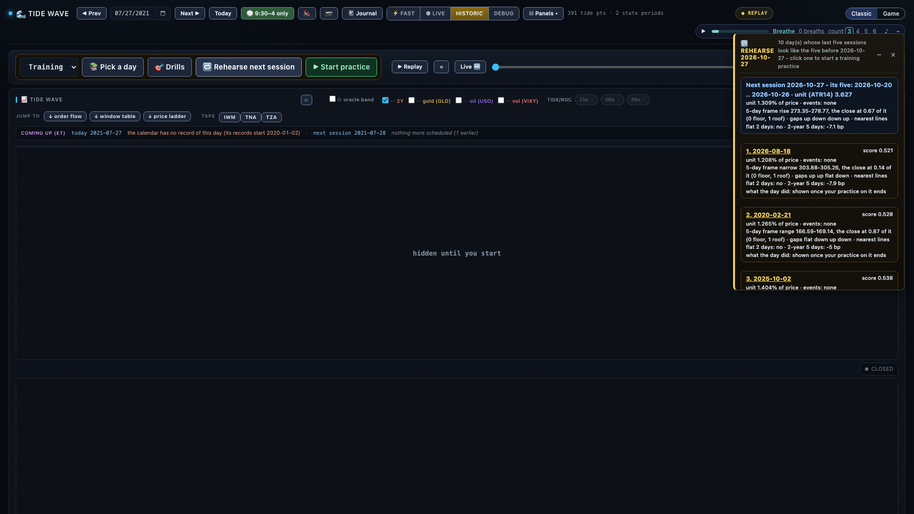
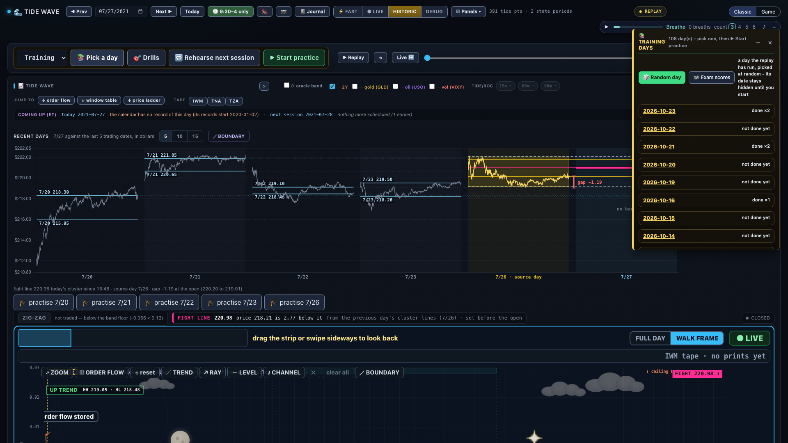
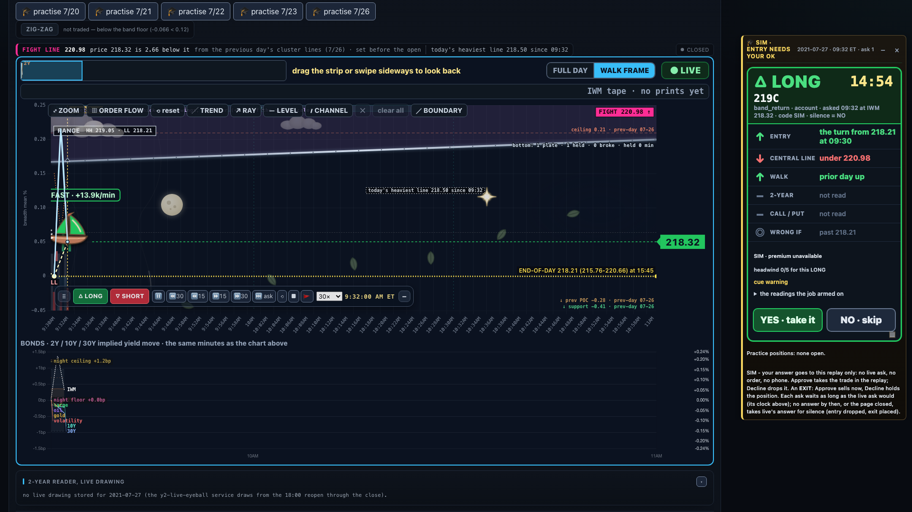
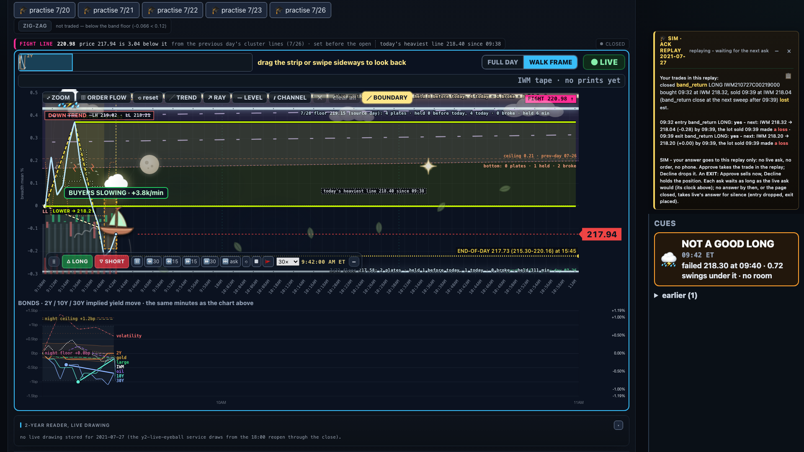
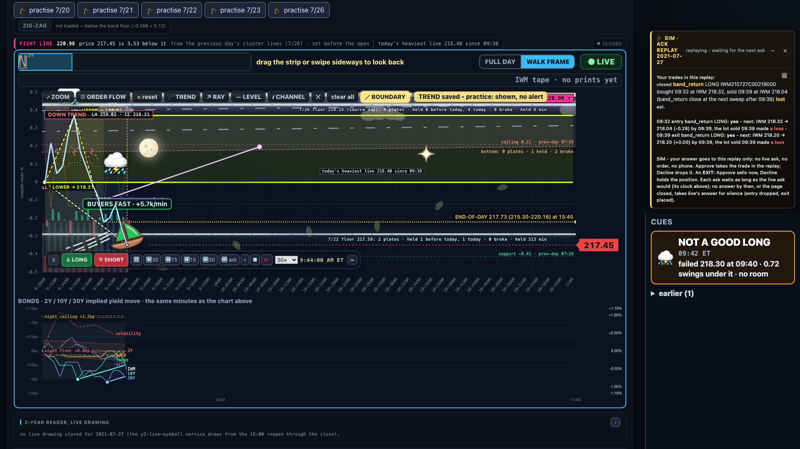
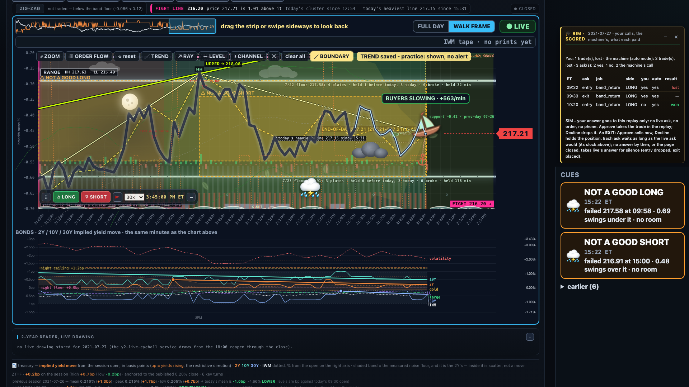
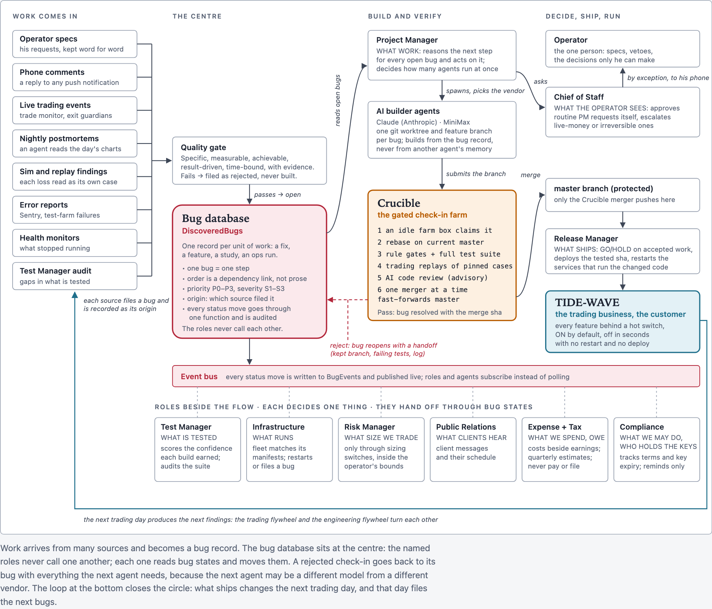

# Tide Wave: an AI-built intraday trading desk, run by one person

> **Not financial advice.** This repository holds only an introduction, screenshots, a short video, a design
> page and a backtest record. There is no trading code here, and nothing shown is a recommendation to buy or
> sell anything.

## 1. Overview

This is a personal project: one person running a small intraday options trading desk on IWM (the Russell 2000
ETF), where the software - and most of the engineering work - is done by AI agents, mostly Claude. I set the
goals, the rules and the design, and review every change; the agents write, test and ship the code.

It has three parts:

| Part | What it is | Where |
|---|---|---|
| **Practice playground** | Replay a past trading day minute by minute and answer the system's trade asks, then compare your calls with the machine's | [below](#2-practice-playground) · [video](https://taijizhu.github.io/tide-wave-practice/) |
| **Foundry** | The engineering framework: a bug database at the centre, AI builder agents, a gated check-in farm, a machine farm | [below](#3-foundry) · [design page](https://taijizhu.github.io/tide-wave-practice/foundry/) |
| **Trading strategies** | The Trade Assistant's strategies and their historic backtest replay record, refreshed as they improve | [below](#4-trading-strategies) · [backtest record](https://taijizhu.github.io/tide-wave-practice/backtests/) |

## 2. Practice playground

**[Watch the video](https://taijizhu.github.io/tide-wave-practice/)** (about two minutes, plays in the browser;
captions also in [`captions.srt`](captions.srt)).

It is for practice only. A practice session replays history, places no orders and never talks to a broker.

### The idea

Reading a chart after the day is over is easy, because you already know how it ended. Making a call while the
day is still unfolding is the hard part. So the tool replays a past day minute by minute and hides everything
that has not happened yet. While it plays, the system's own strategies ask for permission to trade, the same way
they ask during a live session, and I answer each one. When the day ends, my calls are shown next to the calls
the machine would have made.

### How a practice works

#### 1. Pick a day

There are two ways to choose a day:

- **Pick a day** lists training days.
- **Rehearse next session** lists past days whose last five sessions looked most like the five before the coming
  session (see [Rehearse](#rehearse) below).

The day's chart stays covered until the practice starts, so I cannot peek at how it ends.

#### 2. Start a Training practice

I choose **Training** mode and press **Start practice**. The chart then replays from the open, one minute at a
time. In Training mode I can pause, rewind and fast-forward. There is also an Exam mode, which hides the date
and lets the day play only once.

#### 3. Answer the asks

When one of the system's strategies wants to enter or exit, an **ask** appears on the card at the right side
of the screen. The card shows:

- the side (LONG or SHORT) and the option contract;
- the readings at that minute, one per row: the entry turn, the central line, the trend walk, the two-year
  Treasury yield and the call/put flow, each with an arrow showing which way it points;
- a **WRONG IF** line, the price at which the idea would be proven wrong.

I press **YES** to take the trade or **NO** to skip it. An exit ask works the same way: YES sells, NO holds.
If I don't answer before the clock runs out, the ask gets the same default answer the live ask would get.

#### 4. Read the chart: boundary lines and drawing tools

- **BOUNDARY** draws the recent swing highs and lows (higher high, lower high, higher low, lower low), joined
  into an upper and a lower line. The lines are built only from the turns known at each minute, so they grow as
  the day goes on and use no hindsight.
- **Drawing tools** (trend line, ray, level, channel) let me mark my own view on the chart.

#### 5. Fast-forward

The fast-forward buttons skip ahead 15 or 30 minutes, or jump to the next ask. Every minute is still replayed,
so nothing is skipped in the record, and the replay stops at the next ask.

#### 6. The score

When the session ends, the day is scored. Each ask is shown with my answer next to the machine's (what the
system would have done on its own), along with whether each trade won or lost. The goal is not the number. It
is to see where my judgment and the system's differ, and why.

### The bot's opinion

On the live ask card, a small bot face shows the practice agent's own opinion of the ask: *yes* or *skip*, with
a one-line reason. It is a second opinion only. The bot never answers an ask; I always press the button myself.
The practice card in the video does not show the bot yet.

### Rehearse

**Rehearse next session** looks at the five sessions before the coming trading day and finds the past days whose
own five sessions looked most alike. It compares the path of prices, the size of the moves and the two-year
Treasury yield's 5-day change. Each match comes with its readings as of the morning, and one click starts a
Training practice on it. What the matched day actually did is shown only after I finish practising it, so the
rehearsal stays blind.

## 3. Foundry

Foundry is the engineering framework that builds and runs everything above. Work arrives from many sources
(specs, phone comments, live trading events, nightly reviews, replays, error reports) and becomes a record in a
bug database at the centre. A Project Manager agent dispatches AI builder agents, each in its own git worktree;
every change goes through Crucible, a farm of machines that rebases it on master, runs the full test suite,
trading replays of pinned cases and an AI code review, and only then merges it. A small set of named roles -
release, test, risk, infrastructure and others - each decide one thing and hand off through the bug states.

The full design, with the bug lifecycle, a check-in's path through Crucible and the machine farm by role:
**[Foundry design](https://taijizhu.github.io/tide-wave-practice/foundry/)**.

## 4. Trading strategies

The Trade Assistant runs several strategies, each looking for one kind of move in IWM (a return toward the
pre-market range, a break out of it, the opening leg, a walk between price lines, event days, and others). Each
strategy has its own page with its historic backtest replay record: month by month in IWM points, the biggest
losing trades first, the biggest winners, its gap months and the code versions its days came from. The whole
record is also downloadable as CSV/JSON, and it is regenerated from the stored replays as the strategies
improve.

**[Strategy backtest record](https://taijizhu.github.io/tide-wave-practice/backtests/)**

These are backtest replays on historical data - not live trading results, before costs, and not a promise of
future results.

## Disclaimer

This is a personal learning project, shared to show what one person can build with AI. It is **not financial
advice**, and **no trading code is included in this repository**. Account details, sizes and money amounts are
left out of the screenshots, the video and the pages.
